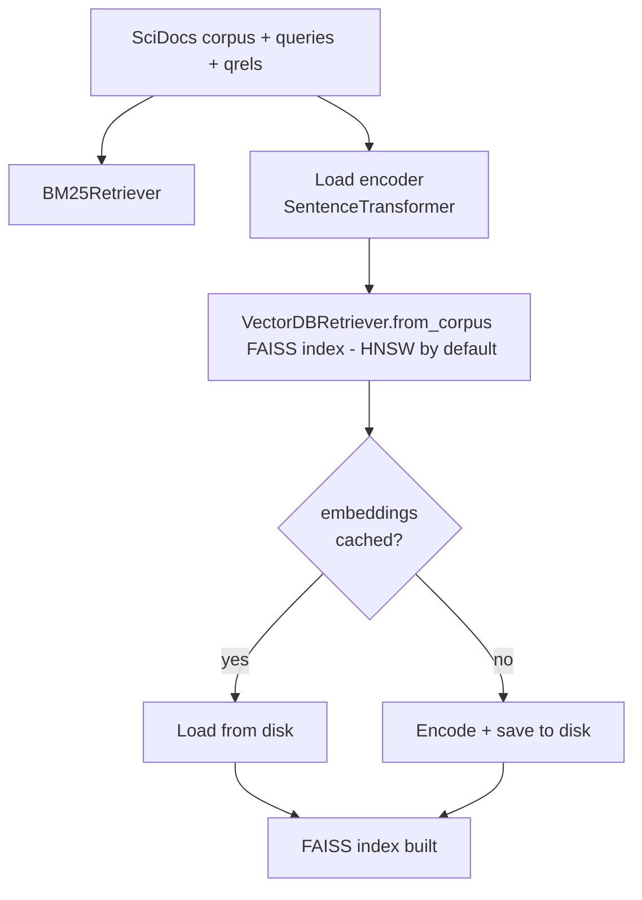
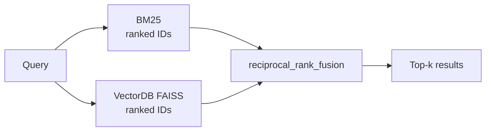
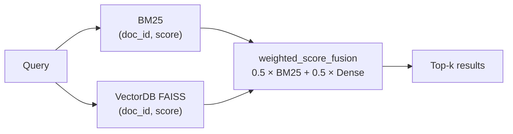
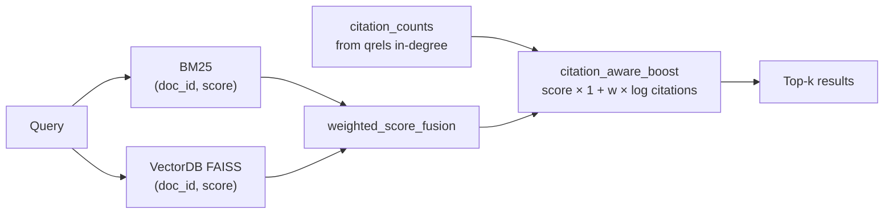

# Optimisations

Three hybrid retrieval approaches built on top of the team's BM25 and VectorDB baselines.

## Files

| File | Purpose |
|---|---|
| `fusion.py` | RRF and weighted score fusion functions |
| `citation_boost.py` | Citation-count re-scoring |
| `reranker.py` | Cross-encoder re-ranking |
| `eval_optimisations.py` | Evaluation engine (mirrors `evaluation/baselines.py`) |
| `run_optimisations.py` | CLI entry point |

## Dataset

Uses the same **BEIR SciDocs** test split as the baselines — downloaded automatically to `data/scidocs/` on first run via `src/data_loader.py`.  
Embeddings are cached to `data/vector_index/embeddings/` so encoding only runs once.

## How to run

```bash
python -m src.optimisations.run_optimisations
```

Results land in `outputs/optimisation_eval.json` and `outputs/optimisation_eval.csv`.  
Concatenate with `outputs/baseline_eval.csv` for a full comparison table.

```bash
# Pick a different FAISS index (flat / ivf / hnsw / ivfpq)
python -m src.optimisations.run_optimisations --index-type ivf

# Tune fusion weights
python -m src.optimisations.run_optimisations --bm25-weight 0.4 --dense-weight 0.6

# Offline (no model download)
python -m src.optimisations.run_optimisations --no-download-dense
```

---

## Pipelines

### Shared setup (runs once for all three)



---

### Approach 1 — RRF Hybrid

> Combines ranked *lists* from BM25 and Dense using Reciprocal Rank Fusion.  
> Score formula: `1 / (k + rank)` summed across both lists.



---

### Approach 2 — Weighted Score Hybrid

> Combines raw *scores* from BM25 and Dense with configurable weights.  
> Default: 50 % BM25 + 50 % Dense.



---

### Approach 3 — Citation-Boosted Hybrid

> Weighted hybrid scores re-adjusted by each document's citation count.  
> Highly-cited papers get a small score bonus.



---

## Baseline comparison

| Metric | TF-IDF | BM25 | Dense (MiniLM) |
|---|---|---|---|
| nDCG@10 | 0.13636 | 0.14950 | 0.21641 |
| MAP@10 | 0.07691 | 0.08688 | 0.12938 |
| Recall@10 | 0.14347 | 0.15428 | 0.23087 |
| P@10 | 0.07060 | 0.07620 | 0.11400 |

Our optimisation results (`outputs/optimisation_eval.csv`) are directly comparable to this table.
