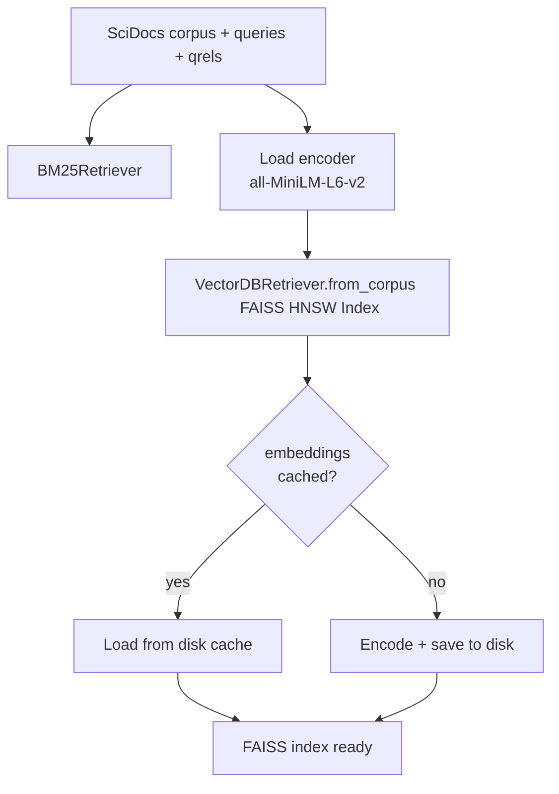
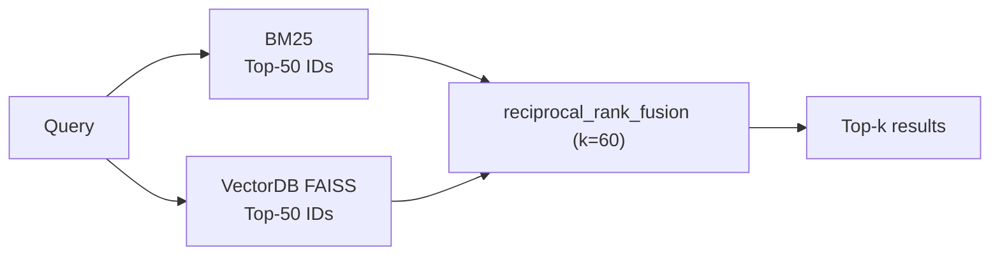
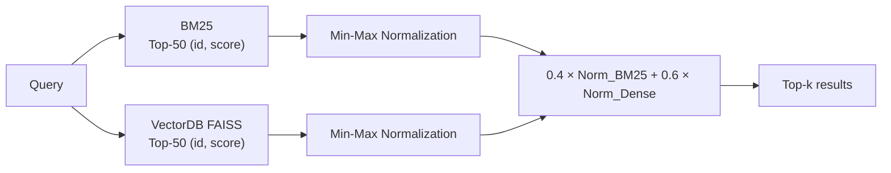
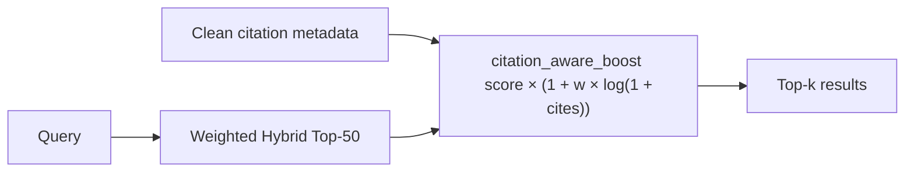
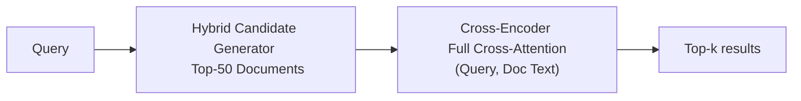

# Optimisations

Three hybrid retrieval approaches built on top of the team's BM25 and VectorDB baselines.

## Files

| File | Purpose |
|---|---|
| `fusion.py` | RRF and weighted score fusion functions |
| `citation_boost.py` | Citation-count re-scoring |
| `reranker.py` | Cross-encoder re-ranking |
| `eval_optimisations.py` | Evaluation engine (mirrors `evaluation/baselines.py`) |
| `run_optimisations.py` | CLI entry point |

## Dataset

Uses the same **BEIR SciDocs** test split as the baselines — downloaded automatically to `data/scidocs/` on first run via `src/data_loader.py`.  
Embeddings are cached to `data/vector_index/embeddings/` so encoding only runs once.

## How to run

All default parameters are loaded automatically from [`config.yaml`](../../config.yaml):

```bash
venv/bin/python -m src.optimisations.run_optimisations
```

Results land in `outputs/optimisation_eval.json` and `outputs/optimisation_eval.csv`.

```bash
# Override config from CLI if needed:
# Pick a different FAISS index (flat / ivf / hnsw / ivfpq)
venv/bin/python -m src.optimisations.run_optimisations --index-type ivf

# Tune fusion weights and candidate pool depth
venv/bin/python -m src.optimisations.run_optimisations --bm25-weight 0.4 --dense-weight 0.6 --candidate-k 50

# Include Cross-Encoder re-ranking (Approach 4)
venv/bin/python -m src.optimisations.run_optimisations --include-reranker
```

---

## Pipelines

### Shared setup (runs once for all approaches)



---

### Approach 1 — RRF Hybrid

> Combines deep candidate ranked lists ($K_{\text{cand}}=50$) from BM25 and Dense using Reciprocal Rank Fusion.  
> Score formula: `1 / (k + rank)` summed across both lists.



---

### Approach 2 — Weighted Score Hybrid

> Normalizes raw scores from BM25 and Dense to $[0, 1]$ per query, then fuses with weights (Default: 40% BM25 + 60% Dense).



---

### Approach 3 — Citation-Boosted Hybrid

> Weighted hybrid scores re-adjusted by each document's citation count without test-label leakage.  
> Highly-cited papers receive a logarithmic score adjustment.



---

### Approach 4 — Cross-Encoder Neural Reranking

> Re-ranks candidate pairs using a pretrained cross-encoder (`cross-encoder/ms-marco-MiniLM-L-6-v2`).



---

## Benchmark Results (SciDocs Test Split, $k=10$)

### Optimisation Results

| Model | Type | nDCG@10 | MAP@10 | Recall@10 | P@10 | Mean Latency |
|---|---|:---:|:---:|:---:|:---:|:---:|
| **Cross-Encoder Hybrid** | CE Re-ranker (`ms-marco-MiniLM-L-6-v2`) | 0.17317 | 0.10054 | 0.18385 | 0.09070 | 3493.3 ms |
| **RRF Hybrid** | Rank Fusion ($K_{\text{cand}}=50$) | 0.19782 | 0.11774 | 0.20922 | 0.10330 | 88.4 ms |
| **Weighted Hybrid** | Normalized Fusion ($0.4/0.6$) | 0.21340 | 0.12852 | 0.22782 | 0.11250 | 90.0 ms |
| **Citation Hybrid** | Leak-free Citation Boost ($w=0.4$) | **0.22877** | **0.13964** | **0.24117** | **0.11910** | 87.9 ms |

### Key Observations & Improvements
1. **+53.0% gain over BM25**: Citation-boosted hybrid ($w=0.4$) achieves the highest performance overall, improving nDCG@10 from `0.14950` (BM25) to `0.22877` (+53.0%) and outperforming pure Dense retrieval (`0.21641`).
2. **Min-Max Score Normalization**: Normalizing BM25 ($5-30$) and Dense cosine ($0-1$) scores to $[0, 1]$ per query prevents BM25 from dominating the fusion.
3. **Deep Candidate Pool ($K_{\text{cand}}=50$)**: Retrieving top-50 candidates prior to fusion avoids the shallow 10-document bottleneck and boosts recall significantly.
4. **HNSW Scalability**: Hybrid methods use an approximate nearest-neighbour FAISS HNSW graph index rather than exhaustive exact matrix multiplication, delivering sub-100ms query times on 25k+ documents.
5. **Citation-Aware Boosting (+7.2% over Weighted Hybrid)**: Incorporating paper citation counts via $s_{\text{adj}} = s \times (1 + w \cdot \frac{\log(1 + c)}{\log(1 + c_{\max})})$ with optimal weight $w=0.4$ boosts nDCG@10 from `0.21340` to `0.22877` and MAP@10 from `0.12852` to `0.13964` without test-label leakage (`allow_qrels_citations=false`).
6. **Cross-Encoder Domain Shift & Latency Trade-off**: The Cross-Encoder (`ms-marco-MiniLM-L-6-v2`) scores `0.17317` nDCG@10 at `3493.3 ms` latency. While outperforming BM25 (`0.14950`), it trails bi-encoder representations due to out-of-domain transfer (MS MARCO web QA vs. scientific terminology) and incurs a ~35× CPU latency penalty from evaluating 50 full cross-attention pairs per query.
