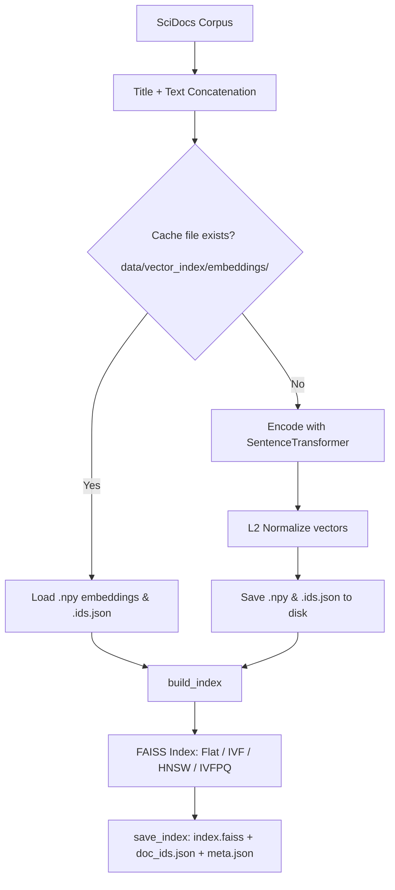

# Vector Database

Persistent vector indexing, low-latency approximate nearest neighbor (ANN) search via FAISS, and embedding caching for SciDocs. Implements `VectorDBRetriever`, which conforms to `BaseRetriever` so it plugs directly into hybrid fusion, reranking, and evaluation.

## Files

| File | Purpose |
|---|---|
| `retriever.py` | `VectorDBRetriever` wrapping FAISS with `retrieve()` and `retrieve_ids()` |
| `index_builder.py` | Builds and configures FAISS indexes (`flat`, `ivf`, `hnsw`, `ivfpq`) |
| `embeddings.py` | Batch text encoding, L2 normalization, and disk caching |
| `store.py` | Serializes/loads FAISS indexes, doc-ID maps, and metadata |
| `build_db.py` | CLI script to build and save an index with sample query verification |
| `benchmark.py` | Evaluates speed, latency, size, and recall-vs-exact across index types |
| `constants.py` | Hyperparameters, index types, cache keys, and file naming rules |

---

## Supported Index Types

| Index Type | FAISS Implementation | Description | Best For |
|---|---|---|---|
| `flat` | `IndexFlatIP` | Exact brute-force search over inner products | Ground truth baseline |
| `ivf` | `IndexIVFFlat` | Voronoi cell inverted lists (`nlist=128`, tunable `nprobe`) | Faster search with clustering |
| `hnsw` *(default)* | `IndexHNSWFlat` | Multi-layer proximity graph (`M=32`, `ef_search=64`) | Best speed / recall trade-off |
| `ivfpq` | `IndexIVFPQ` | IVF + Product Quantization (`M=48`, 8-bit codes) | Low memory footprint |

*Vectors are L2-normalized so inner product equals cosine similarity.*

---

## How to run

### 1. Build and save a database

```bash
# Build default HNSW index
python -m src.vectordb.build_db

# Build with a different index type (flat / ivf / hnsw / ivfpq)
python -m src.vectordb.build_db --index-type ivf

# Use a custom model
python -m src.vectordb.build_db --model sentence-transformers/all-MiniLM-L6-v2
```

Saved artifacts land in `data/vector_index/<model_slug>_<index_type>/`:
- `index.faiss`: Serialized FAISS index
- `doc_ids.json`: Mapping from FAISS internal row index to string document ID
- `meta.json`: Model name, index type, dimension, and search settings

### 2. Benchmark index trade-offs (Speed vs. Accuracy)

```bash
python -m src.vectordb.benchmark
```

Evaluates `flat`, `ivf`, `hnsw`, and `ivfpq` across multiple search parameters against exact search.  
Results are saved to:
- `outputs/vectordb_benchmark.json`
- `outputs/vectordb_benchmark.csv`

---

## Python Usage

```python
from sentence_transformers import SentenceTransformer
from src.data_loader import load_scidocs
from src.vectordb import VectorDBRetriever

corpus, queries, _ = load_scidocs()
encoder = SentenceTransformer("sentence-transformers/all-MiniLM-L6-v2")

# Build from corpus (uses disk cache for embeddings)
retriever = VectorDBRetriever.from_corpus(
    corpus=corpus,
    encoder=encoder,
    index_type="hnsw",
)

# Search
hits = retriever.retrieve("graph neural networks for molecular property prediction", k=10)
# -> [("doc_id", score), ...] sorted descending by score

# Dynamically adjust search parameters on the fly
retriever.set_search_params(ef_search=128)
```

Or load a pre-built index from disk:

```python
from pathlib import Path

retriever = VectorDBRetriever.from_saved(
    index_dir=Path("data/vector_index/sentence-transformers_all-MiniLM-L6-v2_hnsw"),
    encoder=encoder,
)
```

---

## Pipelines

### Index Construction & Caching Pipeline



---

### Query Serving Pipeline


---

## Tests

Tests use a lightweight mock bag-of-characters encoder and synthetic corpus without downloading any models or datasets:

```bash
python -m pytest tests/vectordb/test_vectordb.py -q
```

Or run the test script directly:

```bash
python tests/vectordb/test_vectordb.py
```
